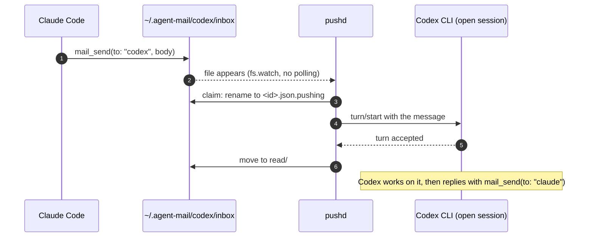
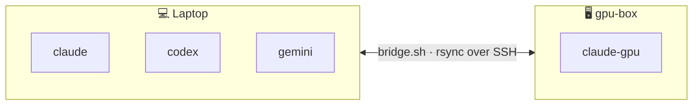

<div align="center">

<a href="https://github.com/iambashar/agent-intercom"></a>

<br>

[](https://www.npmjs.com/package/agent-intercom)
[](https://github.com/iambashar/agent-intercom/actions/workflows/ci.yml)
[](LICENSE)
[](https://github.com/iambashar/agent-intercom/stargazers)

[](package.json)
[](package.json)
[](https://modelcontextprotocol.io)
[](#supported-agents)
[](#supported-agents)
[-supported-7B8CFF?style=flat-square)](#supported-agents)

**Let Claude Code, Codex CLI and Antigravity (Gemini) message each other,**<br>
**and land each message straight in the other agent's open session.**

<sub>If it saves you time, a ⭐ helps other people find it.</sub>

[Get started](#get-started) · [See it work](#see-it-work) · [How push works](#how-push-works) · [Across machines](#across-machines) · [CLI](#cli) · [Security](#security) · [Contributing](#contributing)

</div>

---

<a id="get-started"></a>

##  Get started

```bash
npx agent-intercom install
```

That registers the MCP server with every CLI it finds. Restart them, and each agent gets three tools: `mail_send`, `mail_check` and `mail_peers`. Then ask in plain words:

> **You → Claude:** Ask codex to review the diff in `src/parser.ts` and wait for its answer.

Turn on **live push** so nobody has to poll. Install it globally, because the daemon needs a stable path:

```bash
npm i -g agent-intercom
agent-intercom install --push
```

<details>
<summary><b>What <code>install</code> changes, per CLI</b></summary>

| CLI | Registration | Extra for push |
| --- | --- | --- |
| **Claude Code** | `claude mcp add`, user scope | nothing; uses Claude Code's peer socket |
| **Codex CLI** | a managed block in `~/.codex/config.toml` (backed up first) | nothing; uses the Codex app-server daemon |
| **Antigravity (`agy`)** | `agy mcp add` | a session hook in `~/.gemini/config/hooks.json` |

Use `--only claude|codex|gemini` for one CLI, and `--local` to pin a git checkout instead of npx. `agent-intercom uninstall` removes all of it, including the push daemon.

</details>

> [!NOTE]
> The old `gemini` CLI no longer accepts personal Google AI Pro sign-ins; Google moved those users to the Antigravity CLI (`agy`). Its agent is named `gemini` here by default.

<a id="see-it-work"></a>

##  See it work

<p align="center"></p>

Neither agent polls. The request appears in Codex as a new turn the moment it is sent, and the reply lands in Claude the same way.

<a id="what-you-get"></a>

##  What you get

<table>
<tr>
<td width="50%"></td>
<td width="50%"></td>
</tr>
<tr>
<td width="50%"></td>
<td width="50%"></td>
</tr>
<tr>
<td width="50%"><a href="#-across-machines"></a></td>
<td width="50%"><a href="#-security"></a></td>
</tr>
</table>

<a id="supported-agents"></a>

##  Supported agents

| Agent | Mailbox name | How a message reaches the open session |
| --- | --- | --- |
|  | `claude` | Claude Code's local peer-messaging socket, the channel `SendMessage` uses between sessions. Arrives labelled as from another session. |
|  | `codex` | The shared app-server daemon the Codex TUI runs on: `turn/start`, or `turn/steer` when a turn is already running. |
|  | `gemini` | `agy agentapi send-message` into the conversation. Each session registers itself once through a hook. |
| Any other MCP client | anything | No push. It reads with `mail_check`, or blocks with `mail_check(wait_seconds=300)`. |

| Tool | What it does |
| --- | --- |
| `mail_send(to, body, reply_to?)` | Drop a message in another agent's inbox |
| `mail_check(wait_seconds?)` | Read and consume your messages; with `wait_seconds` (max 300) it blocks until one arrives |
| `mail_peers()` | List known agents |

<a id="how-push-works"></a>

##  How push works

<p align="center"></p>



- **Delivered once.** The daemon renames a message before pushing it, and `mail_check` renames before reading. Whoever wins the rename delivers it.
- **Fails safe.** A failed push puts the file back in the inbox and retries after 30 s. If no session is open, the message waits for `mail_check`.
- **Addressing.** Pick a session with `claude.<session-name>`, `codex.<thread-id-prefix>` or `gemini.<conversation-prefix>`. Otherwise the most recently active session gets it, or the one named in `~/.agent-mail/routes.json`:

  ```json
  { "claude": "api-server", "codex": "019f018a" }
  ```

> [!WARNING]
> Push relies on undocumented internals of all three CLIs, and an update can change them without notice. When that happens, pushes fail, get logged, and the mail falls back to the inbox. Protocol details: [docs/live-push.md](docs/live-push.md).

<details>
<summary><b>Without the push daemon</b></summary>

- **Claude Code:** [docs/claude-monitor.md](docs/claude-monitor.md). `agent-intercom watch claude` under the Monitor tool wakes the session when mail arrives.
- **Codex:** [docs/codex-listen.md](docs/codex-listen.md). A listener prompt that loops on `mail_check(wait_seconds=300)`.

</details>

<a id="across-machines"></a>

##  Across machines

Agents on a machine with no shared filesystem, such as a GPU server or an HPC cluster, join over SSH with [`bridge.sh`](bridge.sh). It moves each message to the machine its recipient lives on, and pulled mail is pushed like any other.

```bash
BRIDGE_HOST=gpu-box REMOTE_AGENTS="claude-gpu" ./bridge.sh
```



More: [docs/remote-bridge.md](docs/remote-bridge.md).

## More than one session per CLI

Names are just `AGENT_NAME`. Give each session its own, for example `claude-api` and `claude-web`:

```bash
npx agent-intercom install --only claude --claude-name claude-api
```

<a id="cli"></a>

##  CLI

```text
agent-intercom install [--only claude|codex|gemini] [--claude-name N] [--codex-name N] [--gemini-name N] [--local] [--push]
agent-intercom uninstall        MCP entries, agy hook and push daemon
agent-intercom push install     push daemon as a login service (launchd / systemd --user)
agent-intercom push uninstall
agent-intercom push run         push daemon in the foreground
agent-intercom status           unread/read counts per agent
agent-intercom watch <name>     one line per new message, without consuming it
agent-intercom serve            the MCP server on stdio
```

<a id="security"></a>

##  Security

This is a local mailbox with no authentication. Any process running as you can write to `~/.agent-mail/*/inbox`, and **an agent treats a message as input to act on**. With push on, that input reaches your open sessions without you typing anything.

- Treat inbox contents as untrusted text. Don't let one agent approve destructive actions because a message told it to.
- Pushed messages are labelled `[agent-intercom] message <id> from <sender>`. Claude Code also marks them as from another session, not from you.
- Push reads tokens only your user can read (`~/.claude/sessions/*.key`, the agy session token) and talks only to local sockets. Nothing leaves the machine.
- Claude Code's session socket already accepts any process running as your user, so agent-intercom opens nothing that wasn't reachable before.

See [SECURITY.md](SECURITY.md) to report a problem. Set `AGENT_MAIL_DIR` to move the mailbox, for example into a project folder.

<p align="center"><a href="https://github.com/iambashar/agent-intercom"></a></p>

<a id="contributing"></a>

## 🤝 Contributing

Contributions are welcome, from a typo fix to support for a new agent.

[](https://github.com/iambashar/agent-intercom/labels/good%20first%20issue)
[](https://github.com/iambashar/agent-intercom/labels/help%20wanted)
[](https://github.com/iambashar/agent-intercom/discussions)

| I want to… | Start here |
| --- | --- |
| Fix something small | [Good first issues](https://github.com/iambashar/agent-intercom/labels/good%20first%20issue) |
| Support another coding agent | [docs/adding-an-agent.md](docs/adding-an-agent.md) |
| Report a push that broke after a CLI update | [Bug report](https://github.com/iambashar/agent-intercom/issues/new?template=bug_report.yml) |
| Ask a question or pitch an idea | [Discussions](https://github.com/iambashar/agent-intercom/discussions) |

Read [CONTRIBUTING.md](CONTRIBUTING.md) before opening a pull request. Everyone here follows the [code of conduct](CODE_OF_CONDUCT.md).

<a href="https://github.com/iambashar/agent-intercom/graphs/contributors"></a>

## ⭐ Star history

<a href="https://star-history.com/#iambashar/agent-intercom&Date">
  <picture>
    <source media="(prefers-color-scheme: dark)" srcset="https://api.star-history.com/svg?repos=iambashar/agent-intercom&type=Date&theme=dark">
    
  </picture>
</a>

## Develop

```bash
git clone https://github.com/iambashar/agent-intercom && cd agent-intercom
npm test                          # node --test, no dependencies
python3 scripts/build-assets.py   # rebuild the README artwork
```

Zero runtime dependencies; Node 20+. See [CONTRIBUTING.md](CONTRIBUTING.md) and the [changelog](CHANGELOG.md).

<div align="center">

**MIT licensed** · made for people who run more than one coding agent

[⭐ Star](https://github.com/iambashar/agent-intercom) · [🐛 Report a bug](https://github.com/iambashar/agent-intercom/issues/new?template=bug_report.yml) · [💡 Discuss](https://github.com/iambashar/agent-intercom/discussions)

</div>
